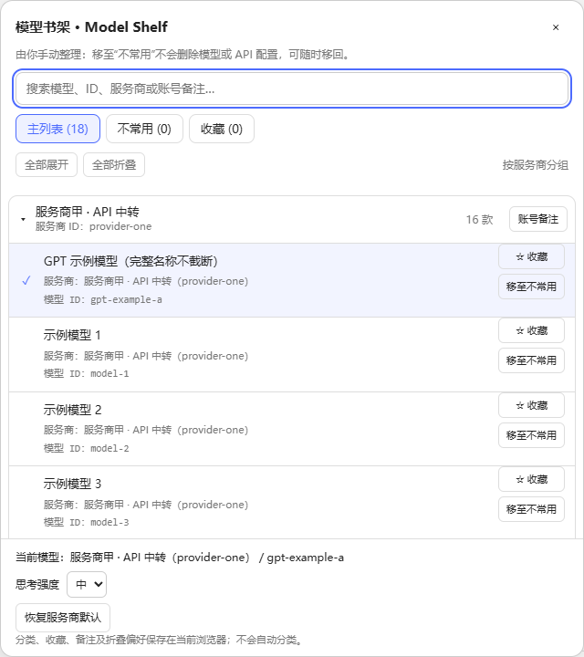
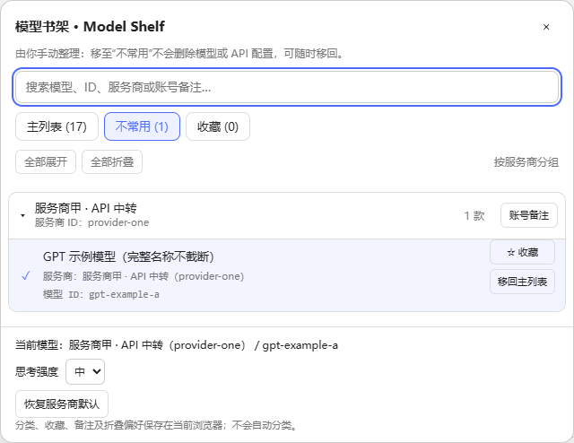
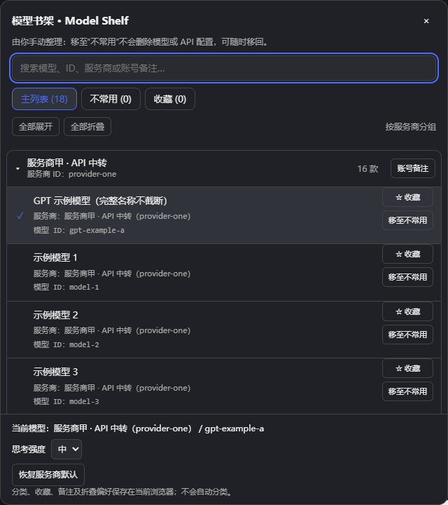
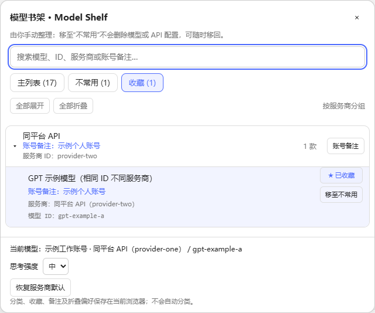

# 模型书架 · DSH Model Shelf

更大的模型选择面板、可折叠的服务商分组，以及**完全由用户手动整理**的“不常用”列表。

> 作者：[Hobartoakes](https://github.com/Hobartoakes) · 许可证：[MIT](LICENSE) · [问题反馈](https://github.com/Hobartoakes/dsh-model-shelf/issues)
>
> 源码采用 MIT 公开。历史预构建安装包见 [GitHub Release](https://github.com/Hobartoakes/dsh-model-shelf/releases)。本项目尚未发布 npm；dsh-market 收录当前状态本轮未核验，详见下方发布状态。

## 1.3.0 · 手动整理与排序

平铺收藏、服务商整组不常用 / 恢复、记住标签页、服务商与收藏手动拖动 / 键盘排序，并保留离线条目的顺序。发布目标：[GitHub Release v1.3.0](https://github.com/Hobartoakes/dsh-model-shelf/releases/tag/v1.3.0)。此链接标识发行目标，不代表归档已上传或公开下载已验证；逐项验证与发布门禁见[发布检查清单](docs/RELEASE-CHECKLIST.md)。

## 演示

以下均为 **1.3.0 之前的历史演示截图**，不代表本版平铺收藏、整组整理与排序界面，也不作为本版安装或 GUI 验收证据。截图来自离线测试页面，所有服务商、模型名称和 ID 均为演示数据，不包含真实对话、密钥或本机配置。

### 主列表：完整身份与服务商分组



### 不常用列表：手动移入，随时移回



### 深色主题



### 收藏列表：手动标记常用模型



## 功能

- 选择面板最大宽度 **640px**、最大高度 **720px**，窗口较小时自动收缩。
- 主列表与不常用按服务商分组，支持单独折叠、全部展开和全部折叠；收藏逐条平铺，无需展开服务商。
- 主列表 / 不常用两个分类，外加独立的**收藏**列表。首次使用时所有模型均在主列表，收藏为空。
- 点击“☆ 收藏 / ★ 已收藏”手动收藏或取消；收藏是快捷入口，不改变主列表 / 不常用分类。
- 服务商分组支持**账号备注**，例如“工作账号 / 个人账号 / 备用账号”；按服务商配置 ID 分开保存，在模型行、当前模型按钮和搜索中显示。
- **分类仅由你决定**：点击“移至不常用”或“移回主列表”。不统计使用频率，不自动分类。
- 移动分类不会选择模型、删除 API 配置或影响其他服务商的同名模型。
- 每款模型显示模型名称、服务商名称、服务商 ID 和精确模型 ID。
- 以 `(provider ID, model ID)` 区分模型；不同服务商的同名模型互不影响。
- 支持搜索模型名称、模型 ID、服务商名称、服务商 ID 和账号备注；搜索作用于当前列表。
- 搜索临时展开匹配分组，不改变原折叠状态。
- 沿用 DSH 原生模型切换和思考强度选项，保留会话锁定与失败提示。
- 思考强度可随时**恢复服务商默认**；未声明档位的模型若装了 `dsh-workbuddy-connect`，可在面板内**就地检测档位**，并在档位旁标注来源（1.2.0）。
- **逐模型上下文容量**：对打了 CTXPATCH 补丁的 `dsh-workbuddy-connect`，面板底部按模型选择 `300K` / `1M` 等它声明的容量，并显示“当前生效”；未打补丁时该控件不出现（1.2.0）。
- 适配宿主浅色 / 深色主题，支持键盘操作。

模型 ID 是服务商目录提供的调用标识。若中转 API 将该标识映射到其他上游模型，插件**无法验证实际上游身份**，不会猜测或额外标注未经验证的模型厂商。

## 兼容性

| 项目 | 已验证范围 |
| --- | --- |
| DSH 宿主 | **0.2.1-rc.2**，元数据暂限定这一版本 |
| 实际环境 | 1.3.0 在 Windows 隔离 DSH_HOME 的真实宿主完成安装 / 禁用 / 重新启用 / 卸载；当前 desktop 安装与现有 GUI 验收另列于发布检查清单 |
| 浏览器回归测试 | 本机 Microsoft Edge；浅色、深色和窄窗口 |
| 必需服务 | 内置 `modelDirectories`、`sessions`、`remote.session` 和 UI slots |
| 替换位置 | `conversation.input.model`，priority `-100` |
| 模型名子插槽 | `conversation.input.model.label`（0.2.1 新增）：本插件**不声明**它，因此书架内的模型名按纯文本显示，不带宿主自带的 1017 徽标。理由见下文 |
| 可选依赖 | `dsh-workbuddy-connect`（1.2.0 的思考强度检测与逐模型容量）。未安装、未登录、路由不可达，或未打 CTXPATCH 补丁时，对应控件不显示，其余功能不受影响 |

尚未验证其他 DSH 版本、macOS 或 Linux。不要绕过宿主的兼容性检查。同一插槽上的其他增强插件可能与本插件竞争；遇到重复界面或未生效时，先关闭其中一个插件。

0.2.1 起，宿主自己也往这个座位里填一个官方选择器（priority `0`），并声明 `conversation.input.model.label` 子插槽给模型名加徽标。本插件以更低的 priority 胜出，因此整张座位（包括模型名的渲染）由本插件负责。

同一个子插槽键只能被声明一次，而 `renderSlot` 只为声明了 `children` 的条目合成。本插件**有意不声明**它：一旦声明，宿主自己的模型选择插件会在每次加载时抛 `slot "…" is already declared`（已实测，且与注册先后顺序无关）。那是把宿主插件搞坏，不是外观损失，因此书架内的模型名按纯文本显示，不带 1017 徽标；原生座位与宿主自带插件完全不受影响。完整的逐项契约核对见 [docs/HOST-COMPATIBILITY.md](docs/HOST-COMPATIBILITY.md)。

## 安装与卸载

以下命令使用 **v1.3.0 的目标归档 URL**，不是公开可用性验证声明。安装前请确认 [Release 页面](https://github.com/Hobartoakes/dsh-model-shelf/releases/tag/v1.3.0)已提供对应附件；上传与公开下载验证状态见[发布检查清单](docs/RELEASE-CHECKLIST.md)。GitHub 预构建包安装无需 npm 账号：

```powershell
dsh plugin --profile desktop add "https://github.com/Hobartoakes/dsh-model-shelf/releases/download/v1.3.0/dsh-model-shelf-1.3.0.tgz" --ignore-scripts
```

如果 CLI 下载受网络限制，可先从 Release 页面下载归档，再使用本地路径（将路径替换为实际归档位置）：

```powershell
dsh plugin --profile desktop add "C:/path/to/dsh-model-shelf-1.3.0.tgz" --ignore-scripts
```

安装后刷新现有 DSH 页面。内置模型选择器保持加载；禁用或卸载本插件后恢复内置选择器。

```powershell
dsh plugin --profile desktop remove dsh-model-shelf
```

归档包含预构建文件，不需要在用户机器上运行安装构建脚本。插件不会修改应用安装包。

早期本地原型名称为 `dsh-model-organizer`。两者占用相同选择器插槽，不建议同时启用；从原型迁移时，先禁用旧插件，再安装新插件。同一浏览器 origin 下首次读取新偏好时，会导入旧原型偏好，且不会删除旧键。已有新偏好时不会覆盖。

## 使用

1. 点击输入框当前模型按钮。
2. 在主列表找到模型，点击右侧“移至不常用”，将该款模型移到独立列表。
3. 切换“不常用”标签页，仍可选择其中的模型，或点击“移回主列表”。
4. 点击服务商标题折叠分组，或使用“全部展开 / 全部折叠”。
5. 点击模型旁的“☆ 收藏”，之后可在“收藏”标签页快速使用。
6. 搜索结果只来自当前列表；未找到时可切换另一列表继续搜索。

手动切换过标签页后，关开面板与刷新都会恢复上次标签（包括空收藏页）。没有上次标签记录时，才按当前模型所在分类打开；不改变模型分类。

### 整组整理与排序（1.3.0）

- 服务商标题旁的“整组移至不常用”覆盖该服务商全部模型（包括以后新增的模型），不删除 API 配置、不切换当前会话模型，也不影响收藏。
- “恢复服务商”只解除整组覆盖，**保留原来的单模型分类**：此前单独移至不常用的模型仍在不常用。覆盖期间，单模型按钮提示“先恢复服务商”。
- 主列表与不常用分别保存服务商顺序；收藏按完整的 `(provider ID, model ID)` 身份逐条排序，可交错排列不同服务商。拖动独立的 ⠿ 把手到同列表另一条目即可移动；文字仍可拖选复制，排序不会选择模型或折叠分组。
- 也可用把手旁的 ↑ / ↓ 上移、下移到相邻可见条目，操作后保留同一条目的焦点并朗读新位置；首条不能上移，末条不能下移。
- 搜索有内容时拖动与上下移均禁用；不支持跨列表拖放。切换标签、改变搜索或源条目离线会取消当前拖动，即使再切回也不会恢复旧拖动。
- 顺序在当前浏览器刷新后保留。初次按当前目录顺序记录，新发现条目和新收藏追加末尾；取消后重新收藏也追加末尾。暂时离线的身份保留排序记录，恢复后回到保留的位置。整组移入/恢复时，该服务商追加到目标分类末尾，其他服务商相对顺序不变。
- 本版已由控制器运行 42 项单元测试、40 项离线浏览器检查（0 个未捕获页面错误）与 7 项真实隔离 profile 集成检查。隔离环境通过不等于当前 desktop 已安装或现有 GUI 已验收；详细边界见[验证报告](docs/VALIDATION.md)。上方历史截图不代表本版界面。

### 收藏与账号备注（1.1.0）

- 在任一列表点击模型旁的“☆ 收藏”，再打开“收藏”标签页使用；取消收藏不删除模型，也不改变原分类。
- 点击服务商标题旁的“账号备注”，输入备注并保存。Enter 保存，Escape 或“取消”放弃编辑，清空后保存可删除备注。
- 同一 API 配置的所有模型共用该账号备注。请勿把 API 密钥、密码或令牌填入备注；备注只在当前浏览器保存。
- 插件**不会自动读取或验证**这个配置实际登录了哪个账号；备注只是你手动贴的标签。

#### 为什么同平台的多个账号要各自建一个 API 配置

插件按**服务商配置 ID**（每行显示的 `服务商 ID：xxx`）保存备注，相当于给每个“抽屉”贴标签：

| 做法 | 结果 |
| --- | --- |
| 只建一个平台配置，在里面换着用两个 Key | ❌ 插件只看到一个 ID，只能贴一个备注，无法区分 |
| 建两个配置（如“工作”“个人”），各填各的 Key | ✅ 两个 ID，可分别备注，模型列表也会分成两组 |

判断方法：打开选择器看 `服务商 ID`。**若两个账号显示的 ID 相同，说明它们在 DSH 里是同一个配置**，需要到宿主的 API 服务商配置里再新增一条。新增后即使两个分组的模型一样，也能分别备注。

### 思考强度：检测与恢复默认（1.2.0）

Dsh 的思考强度由模型目录声明。WorkBuddy 线路的 `deepseek-v4.1-*` 等模型**不声明档位**：档位只能由 `dsh-workbuddy-connect` 向上游探测得出。过去的体验是分裂的——档位要在这个插件的下拉里选，能不能测出来却要在另一个插件的气泡里点。

- **就地检测**：当某模型没有声明档位、且 WorkBuddy 把它列为待检测对象时，面板底部会出现「检测思考强度」。点击后先显示确认（探测会向上游发送请求），确认后由 WorkBuddy 完成探测；成功后面板随即出现档位下拉，并在旁边标注「已探测」。
- **恢复服务商默认**：当前模型被固定过档位时，面板底部出现「恢复服务商默认」。它按“不下发 `reasoningEffort`”恢复为服务商默认，而不是把档位写死成某个值；模型不声明档位时同样可用（此时下拉根本不存在，只能靠这个按钮解除固定）。
- **已检测但面板没更新**：显示「已探测到档位：…（模型面板尚未更新）」和「刷新档位」，不会伪造一个上游并不接受的档位。
- **WorkBuddy 没装 / 没登录 / 探测不可用**：不显示检测入口，其余功能完全不受影响。若已登录但该模型被判定为“接受任意档位取值”，面板会说明因此不提供档位选择。
- 面板只读取 WorkBuddy 的**同源只读状态路由**并用它自己的进程密钥发起操作；检测与容量写入都由 WorkBuddy 在宿主侧完成，授权、限流与“仅本机 + 密钥”校验一律不绕过。状态读取按服务商缓存 60 秒，避免每次打开面板都触发它的额度查询。详见 [跨插件契约](docs/WORKBUDDY-PROBE.md)。

### 逐模型上下文容量（1.2.0，需要宿主补丁）

WorkBuddy 原本只有**一个全局开关**（“使用最大上下文窗口”），一开就让该线路所有模型都跑到最大窗口，不能单独把某个模型留在小窗口。想让“逐模型”真正生效，只能改它自己——所以配了一个独立工程 **`dsh-workbuddy-connect-patch`**（`node patch.mjs --install`）：它给该插件的目录行加一张按模型 id 的容量覆盖表，并新增一个控制动作与状态字段，安装为本地 `file:` 包。

- 打上之后：面板底部出现「上下文容量」，列出该模型声明的每个容量（如 `300K` / `1M`），旁边显示“当前生效”；选「服务商默认」即可解除固定。
- 容量是**按模型**存的（`~/.dsh/.workbuddy-ai-context.json`），换账号也不丢；一个模型固定在 300K 不影响其他模型继续用 1M。
- **没打补丁**：状态文档里没有 `contextWindowPatch`，模型书架直接不显示这个控件，其余功能完全不变——补丁的缺失只会让功能消失，不会让面板出错。
- 上游每次发版后需要重跑补丁脚本；脚本的每一处替换都要求**唯一命中**，上游改动会让它报错而不是改错地方。

### 键盘

- 搜索框中的 ↑ / ↓：高亮结果；Enter：选择模型。
- Tab / Shift+Tab：在面板控件间移动。
- Escape：关闭面板并返回模型按钮；在备注输入框中则只放弃备注编辑，不关闭面板。

## 数据保存与隐私

- 分类（含服务商整组覆盖）、收藏、排序、上次标签页、账号备注和折叠偏好保存在当前浏览器的 `localStorage`，键名为 `dsh-model-shelf.preferences.v1`。
- 保存模型身份、收藏、折叠分组及用户输入的账号备注，不自动读取或保存 API 密钥、对话内容或调用记录。
- 同一浏览器、同一 origin 的窗口共享偏好，刷新后保留。
- 更换浏览器、设备、访问域名或端口后，不保证共享同一份偏好；清除站点数据会重置。
- **目前不跨设备同步，也不纳入 DSH profile 备份。**
- 浏览器存储不可用时显示警告，当前页面仍可操作，但刷新后可能丢失偏好。
- 卸载不主动清空浏览器偏好，便于重装后恢复。
- **不发起任何外部网络请求**；除宿主已有的模型目录与切换接口外，仅在已安装 `dsh-workbuddy-connect` 且当前模型属于它时，向该插件在本机监听的同源路由读取思考强度与容量状态，并在你确认后请它发起探测或写入你选择的容量。插件不读取该插件的私有文件，也不代它绕过授权。

详见 [隐私说明](docs/PRIVACY.md)。

## 开发与测试

```powershell
pnpm install --frozen-lockfile
pnpm run build
pnpm test
pnpm run test:browser
pnpm pack --pack-destination dist-draft
```

`test:browser` 使用离线 HTML 和模拟目录，不启动 DSH 服务器，也不发起真实模型调用。Windows 默认使用已安装的 Edge；其他平台默认尝试已安装的 Chrome。可通过 `DSH_TEST_BROWSER_EXECUTABLE` 指定浏览器程序路径；若当前环境不允许由测试自行拉起浏览器，可用 `DSH_TEST_CDP_URL=http://127.0.0.1:9222` 挂到已用 `--remote-debugging-port` 启动的浏览器上运行同一套检查。其他平台运行测试不等于已验证其 DSH 宿主集成。

另有显式执行的 `pnpm run test:clean-profile`，在 Windows 上用独立 DSH_HOME 和随机本地端口启动临时测试宿主，验证安装 / 禁用 / 重新启用 / 卸载；不替换当前 GUI，结束后停止测试进程。详见 [验证报告](docs/VALIDATION.md)。

React、ReactDOM 和 playwright-core 仅用于开发测试。插件运行时复用 DSH 的 React，不附带第二份 React。

构建是显式步骤，不设置安装期构建钩子。发布前必须重新构建、运行测试，并检查归档内容。

## 发布状态

- 作者：Hobartoakes。
- GitHub 仓库：[Hobartoakes/dsh-model-shelf](https://github.com/Hobartoakes/dsh-model-shelf)。
- 许可证：MIT，详见 [LICENSE](LICENSE)。
- npm 包名：`dsh-model-shelf`，首次发布前查询可用性，查询不等于预留。
- 1.3.0 发布目标：[v1.3.0 Release](https://github.com/Hobartoakes/dsh-model-shelf/releases/tag/v1.3.0)。控制器已完成本版构建、发布文件检查、本地打包及隔离 profile 验证；当前 desktop / GUI 与公开发行门禁以[发布检查清单](docs/RELEASE-CHECKLIST.md)为准，不将授权或目标 URL 视为上传 / 发布证据。
- GitHub Release：[v1.2.0 预构建安装包](https://github.com/Hobartoakes/dsh-model-shelf/releases/tag/v1.2.0)，不需要 npm 注册或登录，含思考强度就地检测、恢复服务商默认与逐模型上下文容量；[v1.1.1](https://github.com/Hobartoakes/dsh-model-shelf/releases/tag/v1.1.1) 修复了界面文字无法拖选复制的问题；[v1.1.0](https://github.com/Hobartoakes/dsh-model-shelf/releases/tag/v1.1.0) 含收藏与账号备注；[v1.0.0](https://github.com/Hobartoakes/dsh-model-shelf/releases/tag/v1.0.0) 为不含这两项功能的历史版本。
- npm：本项目尚未发布，且不是本版计划发行渠道；请勿将裸包名当作可用安装来源。
- dsh-market：历史记录中已提交收录 PR [#7630](https://github.com/awesome-dsh-plugin/awesome-dsh-plugin/pull/7630)，当时尚未合并；本轮未重新核验收录状态，发布 Release 不代表已经收录。

[发布检查清单](docs/RELEASE-CHECKLIST.md) · [版本记录](CHANGELOG.md)

执行 `pnpm run check:release` 检查发布文件；该检查本身不执行上传。本版发行渠道为 GitHub Release，维护者需完成清单中的归档、目标环境与公开下载门禁。最终归档 SHA256 记入 Release 说明，不嵌入归档内文档，以免哈希自引用。干净 profile 的集成验证记录见 [验证报告](docs/VALIDATION.md)。

## English summary

A wide, collapsible model picker for DSH, with Main and Uncommon lists plus a separate Favorites list. Users explicitly move models between lists; no automatic usage-based classification is performed. Each row shows the provider name, provider ID, model name and model ID. Per-provider account notes let you label multiple API accounts on the same platform, saved by provider configuration ID. Preferences are stored in the current browser only; no cross-device synchronization is implemented.

Version **1.3.0** adds flat Favorites, provider-wide Uncommon override/restore, remembered tabs, and manual drag/button-based keyboard sorting with offline order retention. The controller ran 42 unit tests, 40 offline browser checks (zero uncaught page errors), build/release checks, local packaging, and all 7 real isolated-profile installation lifecycle checks; desktop fingerprints stayed unchanged. The [v1.3.0 release target](https://github.com/Hobartoakes/dsh-model-shelf/releases/tag/v1.3.0) and install examples do not assert a verified upload or public download. Exact desktop/live-GUI and publication gates remain in the [release checklist](docs/RELEASE-CHECKLIST.md). npm is not the intended release channel.

Author: **Hobartoakes**. Licensed under **MIT**. Host compatibility remains DSH **0.2.1-rc.2**; historical integration was tested on Windows and Microsoft Edge. Other host versions/platforms are unverified. Historical prebuilt packages are available through GitHub Releases; no npm account is needed to install them. This project has not been published to npm. A market-listing PR was submitted historically; its current status has not been rechecked.
